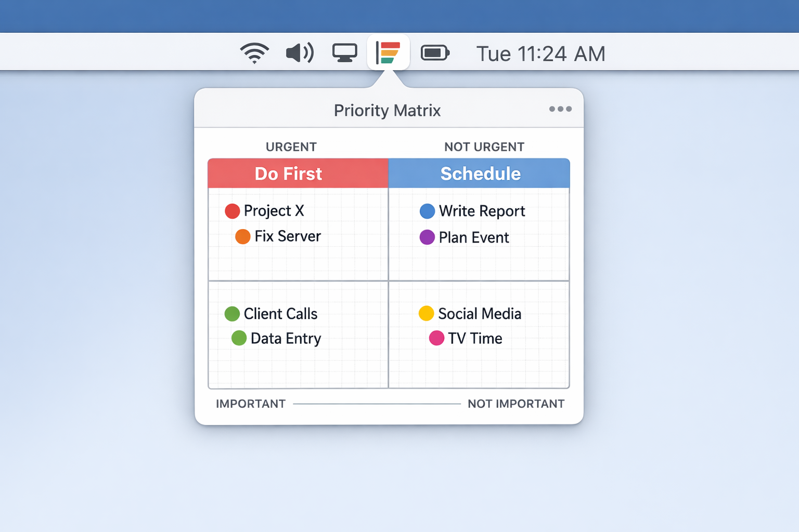

# Prioritizer

Prioritizer is a macOS menu bar app for sorting tasks by urgency and importance. Drag tasks around the Eisenhower matrix as priorities change. Use the ideas panel to capture tasks you want to place later, and the trash panel to review deleted items.

## Run from source

On macOS 13 or later, clone the repository and run this command from the project directory with a Swift 5.9 or later toolchain.

```bash
swift run -c release Prioritizer
```

Click the four-square menu bar icon to open the matrix. Tasks and ideas are saved locally in `~/Library/Application Support/Prioritizer/`.



See [PROJECT.md](PROJECT.md) for implementation details.
